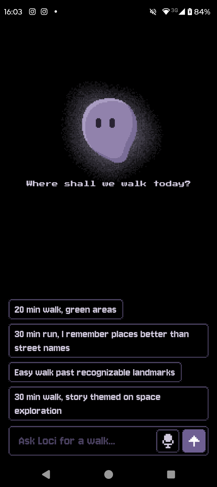
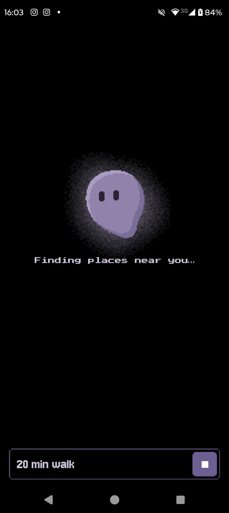
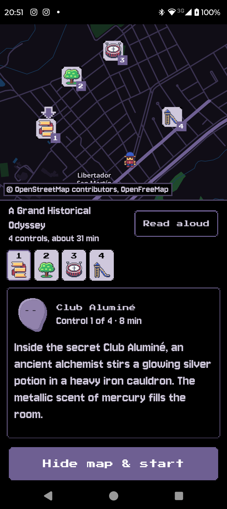
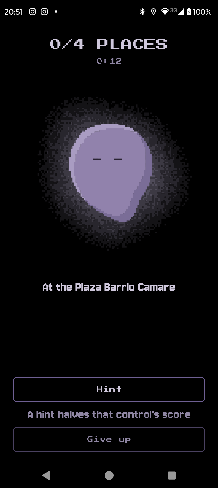
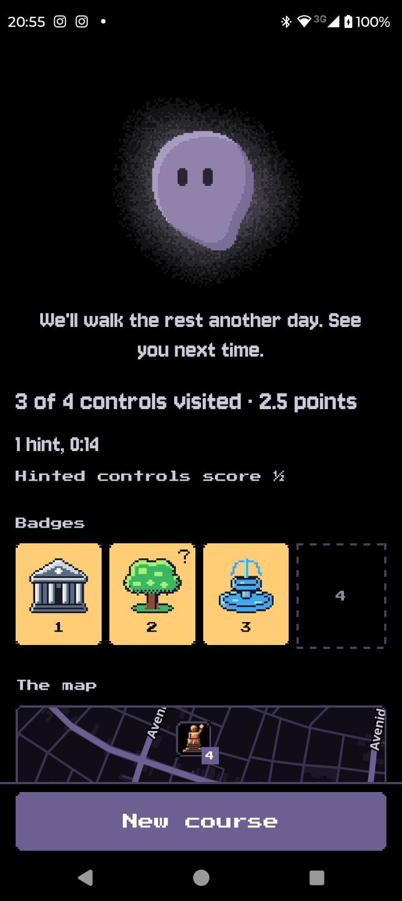
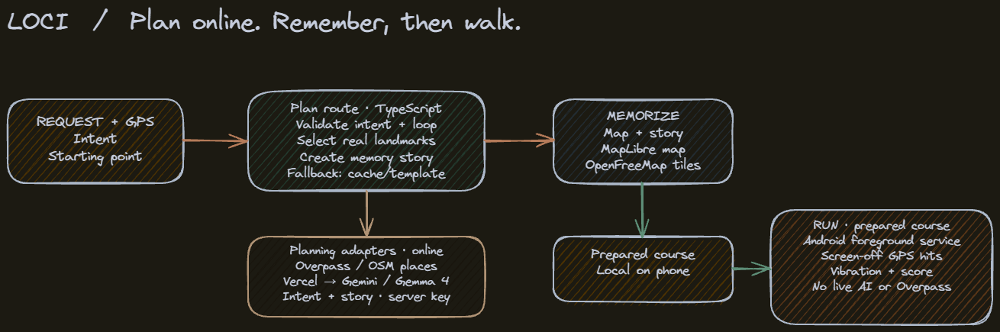

# Loci

Loci is an Android app that plans a walking loop through real landmarks, turns it into a mnemonic story, and asks you to walk it from memory with the phone in your pocket. It is built for the [DEV Hacktoberfest 2026 challenge](https://dev.to/challenges/hf26) (`hf26`, Gemma category).

You ask Loci, a small pixel-art companion, for a route ("20 min walk, green areas") by typing or by voice. Loci finds named places near you in OpenStreetMap and links them into a short story using the method of loci: each place becomes a vivid image, and the images follow one another. You read (or listen to) the story once with the map visible, then hide the map and walk. GPS confirms each checkpoint with a vibration, and at the end Loci shows how many you remembered.

## How a walk works

1. **Ask Loci.** Type or speak a request. Gemma parses it into bounded route parameters (distance or time, pace, preferences, story style). It never invents coordinates.
2. **Plan.** The app generates loop candidates around your position and snaps them to real landmarks from OpenStreetMap through Overpass. Gemma then writes one story fragment per landmark. Only landmark IDs, names and kinds go to the model, and the app validates what comes back.
3. **Memorize.** The map shows numbered checkpoints and the story, which can be read aloud. This is the only time you see the whole route.
4. **Walk from memory.** The map is replaced by a black pocket screen with Loci. The run works offline and with the screen off. A haptic pulse marks each checkpoint. A hint replays one place's story fragment and gives a direction, at the cost of half that checkpoint's score. Giving up is always available and reveals the map.
5. **Results.** Badges, points adjusted for hints, and the map with what you visited and missed.

| Ask Loci | Planning | Memorize |
| :---: | :---: | :---: |
|  |  |  |

| Walk from memory | Results |
| :---: | :---: |
|  |  |

## Features

- **Loci, the companion.** An animated pixel-art character with waiting, listening, hint and celebrate states. It is the interface for asking, memorizing, running and finishing a route.
- **Chat-style home with voice input.** Type a request or dictate it with the microphone button.
- **Real places.** Landmarks come from OpenStreetMap; 18 kinds are drawn as original 32x32 sprites.
- **Gemma story.** An open Gemma model writes the mnemonic story and parses the request. If it fails, the app falls back to cached or template stories.
- **Offline run, map hidden.** Route planning needs a connection; the walk itself does not.
- **Haptic GPS checkpoints.** Location tracking keeps working with the screen off.
- **Hints that cost score.** A hinted checkpoint counts at half credit.
- **Read-aloud story.** Android text-to-speech reads the story and the hints.
- **Reduced motion.** Animations switch to static poses when the system asks for it.
- **Never locks your phone.** Calls and emergency help stay reachable. Loci is not turn-by-turn navigation and makes no claim that a route is safe.

## Gemma and the proxy

Gemma has two jobs: turn the free-text request into structured route parameters, and write the story. It does not choose coordinates or landmarks. In production the app calls a hosted Gemma model through a small server-side proxy (`proxy/`, a single Vercel function) that holds the Gemini API key, fixes the model, caps input and output sizes and applies best-effort rate limiting. The key never ships in the APK. In development the app can talk to a local Ollama instead. See [`proxy/README.md`](proxy/README.md).

## Getting started

### Prerequisites

- Node.js and npm.
- An Android device (USB debugging on) or an emulator, plus the Android SDK and a JDK for native builds.
- A development build is required: the app uses native modules (MapLibre, location, speech recognition) that Expo Go does not include.

### Install

```bash
npm install
```

### Configure the LLM backend

The app reads its backend from `EXPO_PUBLIC_*` variables, for example in a `.env.local` file at the repository root (not committed):

```bash
# Hosted Gemma through your deployed proxy (no trailing path)
EXPO_PUBLIC_LLM_PROXY_URL=https://<your-project>.vercel.app
```

If `EXPO_PUBLIC_LLM_PROXY_URL` is unset, the app uses Ollama for development. Optional overrides: `EXPO_PUBLIC_OLLAMA_URL` and `EXPO_PUBLIC_OLLAMA_MODEL`. A phone can reach an Ollama running on your computer with `adb reverse tcp:11434 tcp:11434`. These variables are inlined at bundle time, so restart Metro after changing them.

### Run the proxy

Deploy or run the proxy as described in [`proxy/README.md`](proxy/README.md). It needs a `GEMINI_API_KEY` from Google AI Studio.

### Build and run

```bash
npx expo run:android   # builds and installs the development build (first time, or after native changes)
npx expo start         # starts Metro for JavaScript changes
```

`npm run android` is the same as `npx expo run:android`. For a release APK, run `npx expo run:android --variant release`; the repository has no dedicated release script.

## Scripts and testing

| Command | What it does |
| --- | --- |
| `npm test` | Jest unit tests (`jest-expo`) |
| `npm run typecheck` | `tsc --noEmit` |
| `npm run lint` | `expo lint` |
| `npm start` | Metro dev server |
| `npm run android` | Build and run on Android |

The domain core and adapters were built test-first. Pure view models live under `src/ui/model/` with co-located `*.test.ts` files, so screen logic is tested without rendering. Layout and visuals were checked by hand on a device. The current suite has 566 tests in 58 suites; the `proxy/` tests run with the same `jest` command and use no network.

## Architecture



The code follows a hexagonal layout: the core does not know about React Native, HTTP or storage.

- `src/domain/` pure TypeScript: distances, loop candidates, landmark selection, intent validation, run session, hints and scoring, plus the ports (interfaces) the rest implements. No React Native imports.
- `src/application/` use cases that compose the domain: `planRoute`, the visited-landmark history and the configuration of the composition root.
- `src/adapters/` the outside world behind ports: `overpass/` (landmark source with mirror fallback), `llm/` (proxy and Ollama clients, story templates and cache), `storage/` (local history).
- `src/ui/` components, view models in `model/`, state, and the theme and palettes.
- `src/app/` Expo Router routes: `index` (Loci chat home), `memorize`, `run`, `results`.

Other folders: `proxy/` (LLM proxy), `assets/` (icons, branding), `scripts/` (icon and splash generators), `docs/` (diagrams, screenshots, post draft), `odd/tasks/` (feature plans and evidence).

## Design

Loci is a night-time, Game Boy-era RPG overworld: a black field, a violet companion, original pixel-art sprites and pixel type. [`DESIGN.md`](DESIGN.md) holds the design system (palette, typography, components) and [`PRODUCT.md`](PRODUCT.md) the product intent, users and principles.

## Credits and licenses

- Map data and landmarks: [OpenStreetMap](https://www.openstreetmap.org/copyright) contributors, available under the Open Database License (ODbL), queried through Overpass.
- Map tiles: [OpenFreeMap](https://openfreemap.org/), rendered with MapLibre and recolored for the night palette. The map shows the required attribution.
- Model: [Gemma](https://ai.google.dev/gemma) by Google, used under the [Gemma terms of use](https://ai.google.dev/gemma/terms).
- Fonts: Press Start 2P and Jersey 10 through `@expo-google-fonts`, both under the SIL Open Font License.
- Sprites: original artwork; the sprite tones come from the Sweetie 16 palette by GrafxKid.
- App code: [MIT License](LICENSE), copyright 2026 teofurlan.
